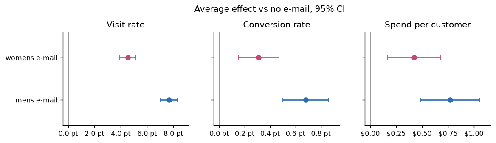
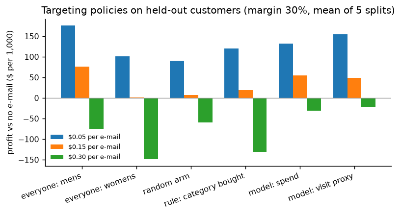
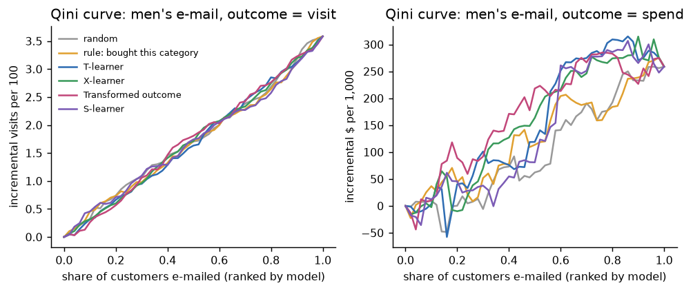

# E-mail Experiment & Uplift Modeling

A complete analysis of a real randomized marketing experiment, the way a data scientist would run it at a
company: **check that the experiment is valid → measure the effects with honest uncertainty → find out who
responds → turn it into a decision about who should get which e-mail, and what that is worth.**

Data: the [Hillstrom MineThatData e-mail experiment](http://www.minethatdata.com/Kevin_Hillstrom_MineThatData_E-MailAnalytics_DataMiningChallenge_2008.03.20.csv):
64,000 customers randomly split into three equal groups: a **men's merchandise e-mail**, a **women's merchandise
e-mail**, or **no e-mail**. Visits, purchases and spend (USD) were tracked for two weeks.



## Findings

1. **The experiment is valid.** Group sizes match the planned 1/3 split (sample-ratio test p = 0.90)
   and every pre-treatment covariate is balanced (largest standardized difference 0.014).
2. **Both e-mails work; the men's e-mail works better.** Men's: visits **+7.7 percentage points**
   (+72%), spend **+$0.77** per customer
   (95% CI $0.49–$1.05). Women's: visits +4.5 points,
   spend +$0.42. All six effects survive a Holm correction for multiple comparisons.
3. **CUPED did not help here, and that is the correct result.** Variance reduction with last year's spend as the
   covariate: **0.4%**; with every pre-treatment covariate (regression adjustment):
   2.9%. CUPED removes about ρ² of the variance, and last year's total spend barely
   predicts a two-week visit. A simulation shows the payoff with a real pre-period metric: ρ = 0.7 → 49% less
   variance, the same precision with half the customers.
4. **Peeking is dangerous.** In 2,000 simulated A/A tests checked 10 times, stopping at the first p < 0.05 declares a
   winner **18%** of the time instead of ~5%.
5. **Uplift models barely beat simple rules.** For visits after the women's e-mail, the rule "e-mailed category
   = category bought last year" ranks customers better than every ML model (Qini 0.40
   vs 0.35 for the best model). For spend, the T-learner and transformed-outcome models beat random targeting
   (Qini 21 ± 7 and 23 ± 14 dollars per 1,000 across 5 splits), but the S-learner swings from split to split
   (−1 ± 45): a sparse, heavy-tailed outcome (under 1% of customers buy) gives little signal per customer.
6. **The decision: send the men's e-mail to everyone, as long as an e-mail costs less than about $0.23.**
   At a 30% margin, the men's e-mail adds ~$0.23 of profit per customer, so blanket sending is the best
   policy at $0.05 per e-mail (**+$176 per 1,000 customers**) and still the best at $0.15 (+$76 vs +$54 for the
   best model-based policy; the confidence intervals overlap). At $0.30 nothing is profitable; the models only lose less because they e-mail fewer
   people. **Uplift modeling would need a stronger signal (more data, or a higher-value outcome) to pay for its
   complexity here.**



## Results

### Average effects (difference in means, 95% CI, Holm-adjusted p)

| E-mail | Metric | No e-mail | E-mail | Effect [95% CI] | Relative |
|---|---|---|---|---|---|
| mens | visit | 10.62% | 18.28% | 7.66% [7.00%, 8.32%] | +72% |
| mens | conversion | 0.57% | 1.25% | 0.68% [0.50%, 0.86%] | +119% |
| mens | spend | $0.653 | $1.423 | $0.770 [$0.485, $1.055] | +118% |
| womens | visit | 10.62% | 15.14% | 4.52% [3.89%, 5.16%] | +43% |
| womens | conversion | 0.57% | 0.88% | 0.31% [0.15%, 0.47%] | +54% |
| womens | spend | $0.653 | $1.077 | $0.424 [$0.169, $0.680] | +65% |

### Targeting policies (profit vs sending nothing, $ per 1,000 customers, margin 30%)

Estimated on held-out customers by inverse-propensity weighting; mean over 5 random 70/30 splits. Full table with
confidence intervals: [`results/RESULTS.md`](results/RESULTS.md).

| Policy | $0.05 per e-mail | $0.15 per e-mail | $0.30 per e-mail |
|---|---|---|---|
| everyone: mens | +176 | +76 | -74 |
| everyone: womens | +101 | +1 | -149 |
| random arm | +91 | +7 | -60 |
| rule: category bought | +120 | +20 | -130 |
| model: spend | +132 | +54 | -31 |
| model: visit proxy | +154 | +48 | -22 |



## Methods

| Step | Method | Why |
|---|---|---|
| Validity | Sample-ratio mismatch (chi-square), standardized mean differences | A broken randomization makes every later number meaningless, so it is checked first. |
| Effects | Difference in means with Welch standard errors; percentile bootstrap for spend | Spend is heavy-tailed (most customers spend $0), so the normal approximation is double-checked. |
| Multiple testing | Holm–Bonferroni over 2 e-mails × 3 metrics | Six tests at α = 0.05 would give a 26% chance of at least one false positive. |
| Variance reduction | CUPED; OLS regression adjustment with HC1 robust errors | Narrower confidence intervals for free when a pre-period covariate predicts the outcome. |
| Planning | Normal-approximation sample size and minimum detectable effect; peeking simulation | The experiment could detect a 0.85% change in visits but only 0.22% in conversion. |
| Who responds | S-, T- and X-learner and transformed-outcome regression (LightGBM); Qini curves and Qini coefficient | No individual ground truth exists, so models are judged by how well they rank on held-out data. |
| Decision | Self-normalised inverse-propensity weighting; paired bootstrap CIs | Propensities are known (1/3 each), so any targeting policy can be valued on the experiment's own data without a new test. |

Model settings were fixed in advance (shallow trees, large leaves, because the signal is weak) and not tuned on the
test splits. Every estimator is tested on synthetic data with a known answer (`tests/`).

## Run it

**Windows:** double-click `run.bat`. **macOS:** double-click `run.command`. The first run installs the packages,
runs the analysis (~4 minutes) and opens the dashboard. No API key or GPU is needed.

```bash
python -m venv .venv && source .venv/bin/activate      # Windows: .venv\Scripts\activate
pip install -r requirements.txt
python -m analysis.run_all      # downloads the data (4 MB, checksum-verified) and writes results/ and figures/
streamlit run app.py            # dashboard: readout, CUPED simulator, Qini curves, what-if targeting, power calculator
python -m pytest                # 16 tests on synthetic data with known answers
```

## Project layout

```
uplift/
  data.py         download (checksum-verified), cleaning, features, stratified splits
  experiment.py   SRM, balance, difference in means, CUPED, regression adjustment, bootstrap, Holm
  power.py        sample size, minimum detectable effect, peeking simulation
  models.py       S/T/X-learners, transformed outcome, Qini curve and coefficient, uplift@k
  policy.py       targeting policies, IPW policy value, paired bootstrap
analysis/run_all.py   every number and figure in this README
app.py                Streamlit dashboard
tests/                16 tests
results/, figures/    outputs (committed so they can be read without running anything)
```

## Stack

Python · pandas · NumPy · SciPy · statsmodels · scikit-learn · LightGBM · matplotlib · Plotly · Streamlit · pytest

## License

Code: MIT. The Hillstrom dataset was published by Kevin Hillstrom (MineThatData) for public analysis; it is
downloaded by the code, not redistributed here.
